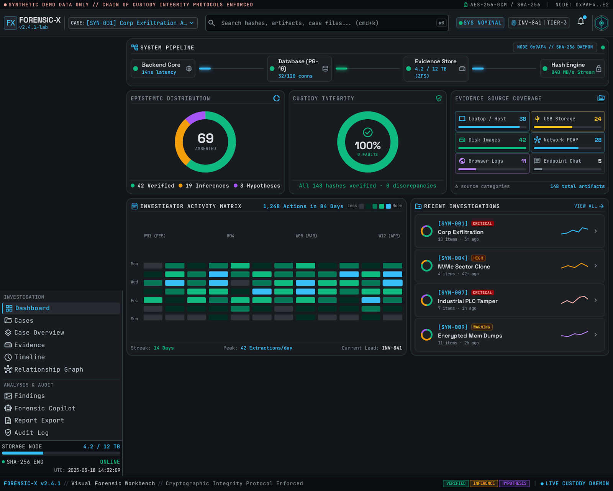
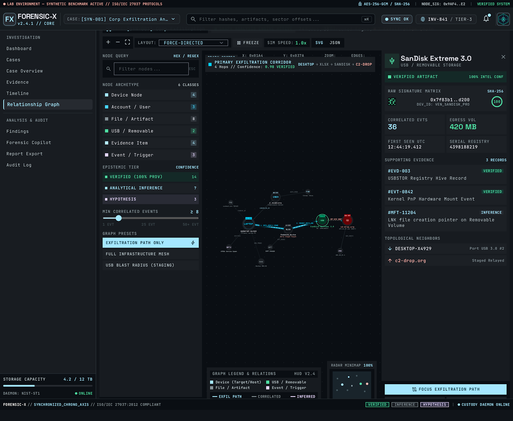
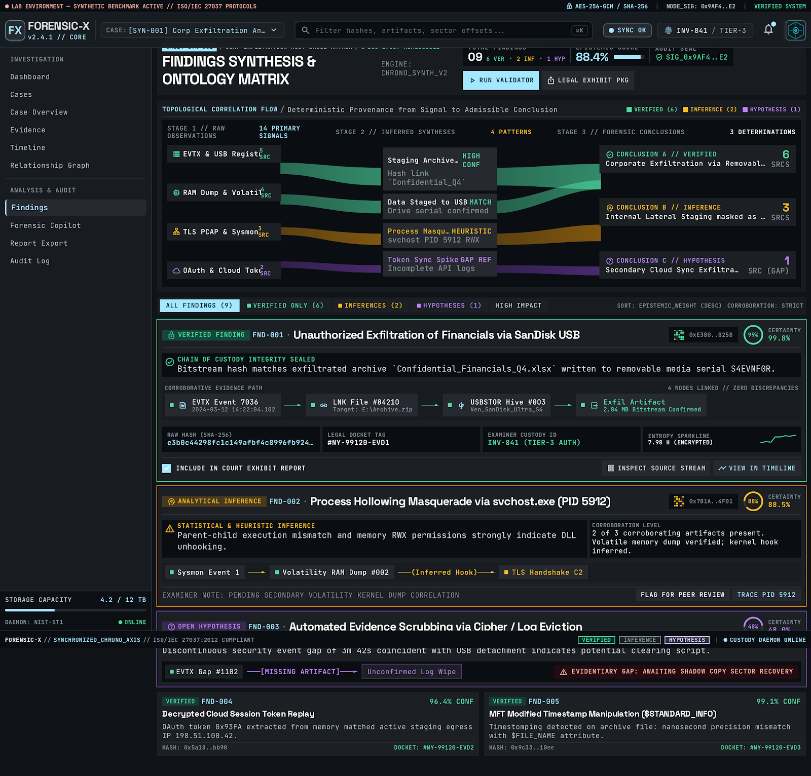
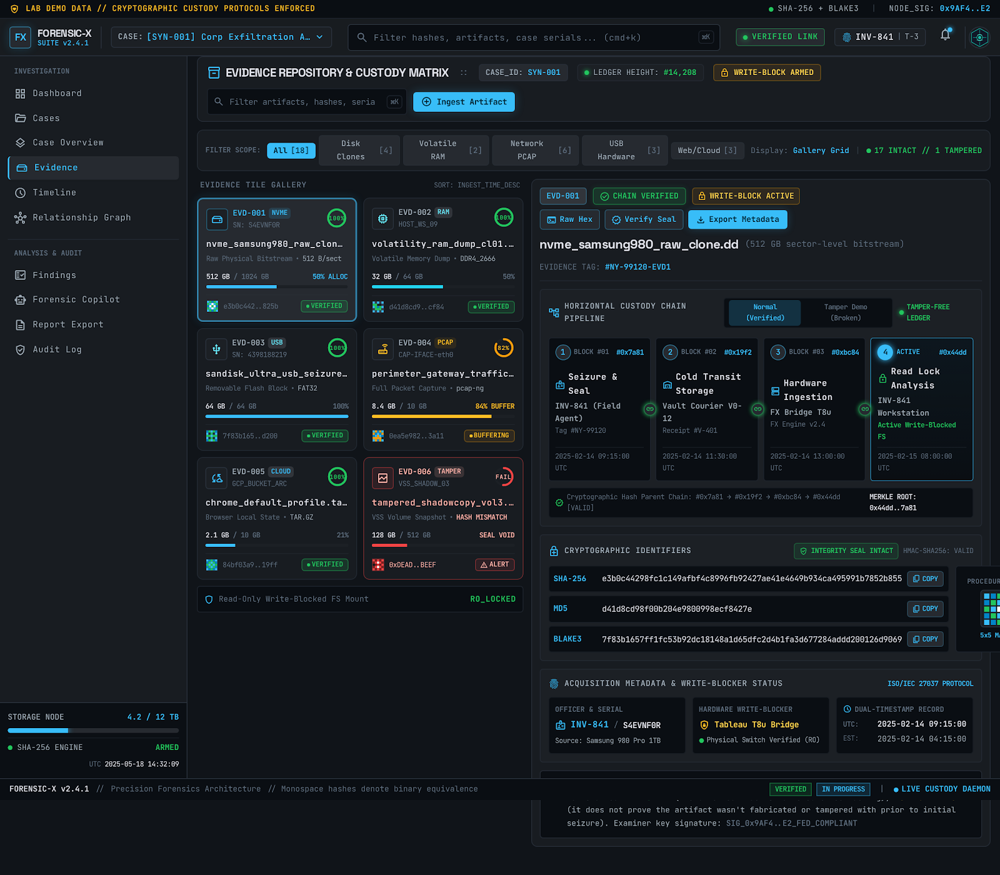
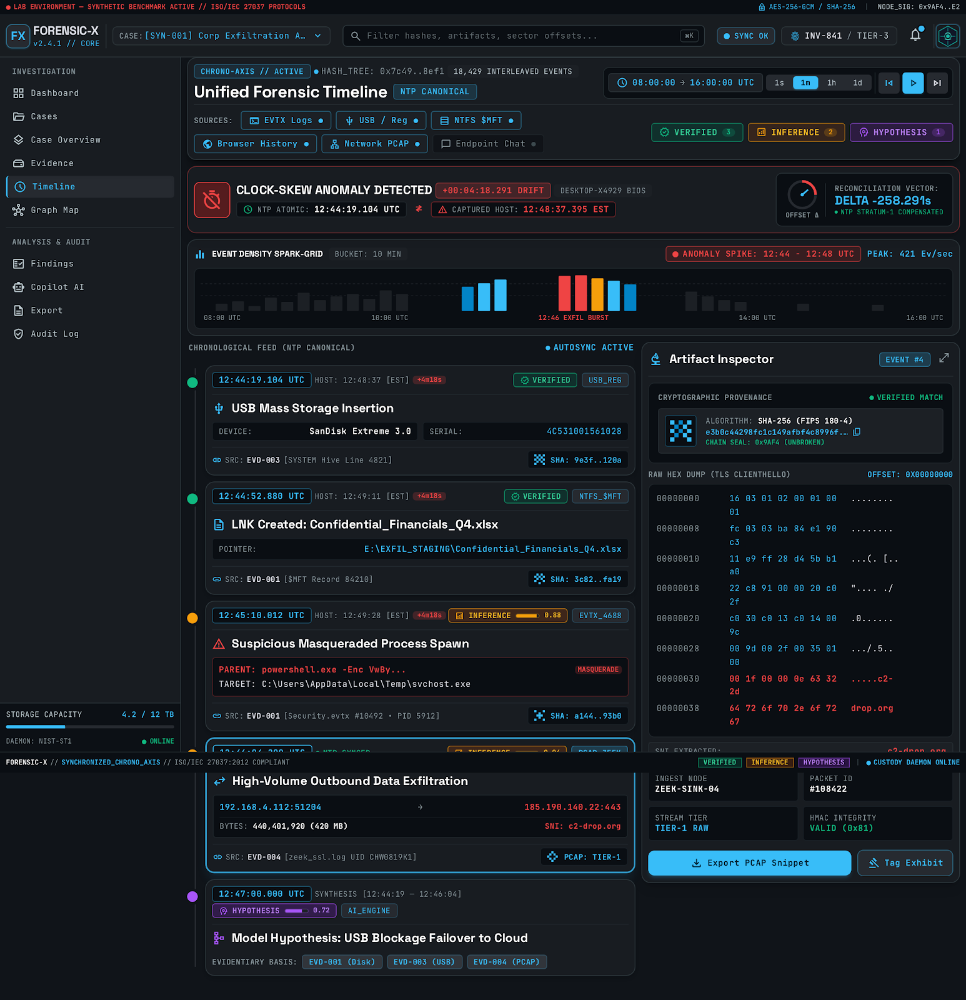
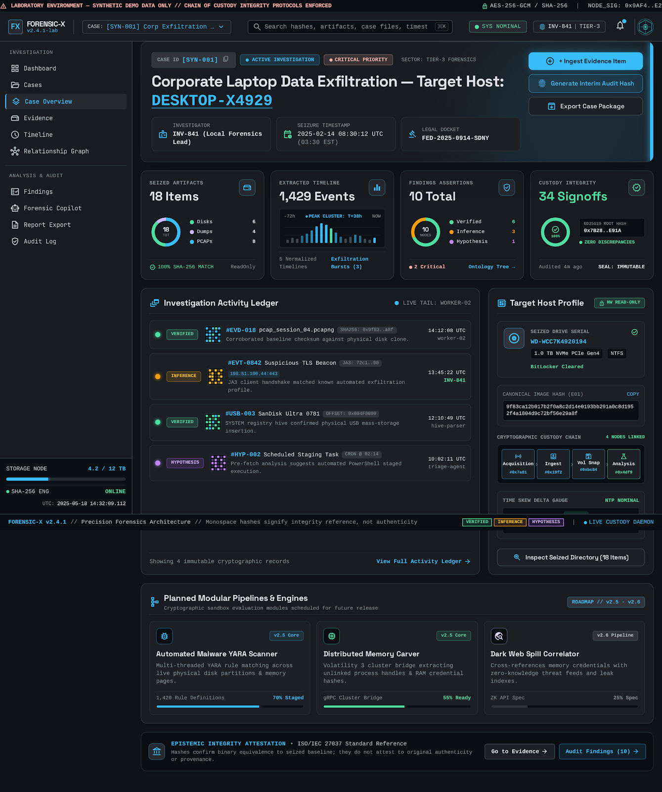
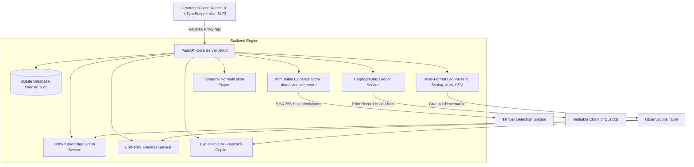

<div align="center">

# 🔬 FORENSIC-X
### Verifiable Digital Forensics & Incident Reconstruction Framework

[](https://opensource.org/licenses/Apache-2.0)
[](https://www.python.org/)
[](https://fastapi.tiangolo.com/)
[](https://react.dev/)
[](https://www.typescriptlang.org/)
[](https://tailwindcss.com/)
[](#cryptographic-chain-of-custody)
[](#-testing--verification)

**FORENSIC-X** is an end-to-end verifiable digital forensics and incident reconstruction framework engineered to bridge raw digital artifacts and court-admissible forensic reconstructions. Built on strict **epistemic truth separation (ADR-006)**, an **immutable on-disk evidence store**, a **cryptographic blockchain-style chain-of-custody ledger**, an **entity knowledge graph**, and an **explainable AI Forensics Copilot**, it eliminates evidence contamination, hallucinated assertions, and retroactively falsified audit trails.

[Quickstart](#-quickstart-guide) • [Visual Showcase](#-visual-showcase) • [Architecture](#-system-architecture) • [Epistemic Tiers](#-epistemic-truth-hierarchy) • [Roadmap](#-roadmap) • [Documentation](DOCS/)

</div>

---

## 📸 Visual Showcase

Explore the interactive interface and investigative tools built for **FORENSIC-X**.

### 1. Central Pipeline & Visual Telemetry Dashboard
Real-time pipeline telemetry (Backend Core, Database, ZFS Evidence Store, Hash Engine), SVG Epistemic Distribution donut, Custody Integrity radial gauge, Evidence Source coverage, and a 12-week investigator activity heatmap.


---

### 2. AI Forensics Copilot & Explainable Interpretations (`Ctrl+J`)
Deterministic forensic reasoner with adversarial prompt-injection defense. Synthesizes formal incident briefs with $T_0$ delta chronologies, runs anomaly scans, formulates hypotheses with corroboration checklists, and promotes AI deductions into official case findings with 1 click.

---

### 3. Entity Relationship Graph
Multi-entity knowledge graph connecting hosts, user accounts, files, USB removable devices, and external IPs into directed attack-chain sequences with blast-radius inspection.


---

### 4. Epistemic Findings & Truth Tiers
Explicit demarcation of facts into **Verified Observations** (disk byte truth), **Analytical Inferences** (correlations requiring explicit leaps), and **Investigative Hypotheses** with clickable observation citations.


---

### 5. Multi-Format Evidence Log Parsers & Observations Matrix
High-throughput stream parsers for Linux Syslog, SSH Auth logs, and CSV USB registries, extracting granular forensic observations linked back to source file offsets and line numbers.


---

### 6. Temporal Event Reconstruction
Harmonized chronological sequence displaying incident deltas ($T_0$), raw timestamp mapping, NTP drift adjustments, and normalized UTC markers.


---

### 7. Case Overview & Cryptographic Audit Dossier
Comprehensive case tracking displaying seized artifact metrics, timeline clusters, and on-demand chain-of-custody auditing with interim Merkle-style audit hashes.


---

## 🏛 System Architecture

FORENSIC-X is designed around an append-only, tamper-evident architecture:



### Core Architecture Principles
1. **Immutable Storage ([ADR 004](DOCS/adr/004-evidence-storage.md))**: Ingested physical artifacts are written to `data/evidence_store/<case_id>/` and marked read-only.
2. **Cryptographic Chain of Custody**: Every custody action (`ACQUIRED`, `VERIFIED`, `ACCESSED`) links to the hash of the preceding record (`prior_record_hash`). Any database alteration breaks the chain.
3. **UTC Normalization**: Disparate log formats (syslog, auth.log, Windows EVTX, CSV) are normalized into ISO 8601 UTC with relative offset computation ($T_0$).
4. **Epistemic Truth Separation ([ADR 006](DOCS/adr/006-epistemic-tiers.md))**: Physical data is clearly demarcated from AI deductions or investigator hypotheses. AI deductions are forbidden from claiming the status of direct observations.
5. **Untrusted Input Defense**: Forensic evidence is untrusted; raw log contents are sanitized against prompt-injection overrides before analysis.

---

## 🧭 Epistemic Truth Hierarchy

FORENSIC-X categorizes all investigative knowledge into three distinct tiers:

| Tier | Name | Epistemic Basis | Requirement | Example |
|---|---|---|---|---|
| **Tier 1** | **Verified Observation** | Cryptographically verified disk bytes, exact log records, file hashes. | Direct artifact provenance & SHA-256 match. | `SHA-256: 59fa4e...` matching physical file on disk |
| **Tier 2** | **Analytical Inference** | Machine correlations or investigative leaps derived from two or more Tier 1 facts. | Mandatory explicit reasoning leap & citations. | USB device plugged in at `08:15` followed by file copy to `E:\` at `08:22` |
| **Tier 3** | **Investigative Hypothesis** | Plausible scenarios or motive theories requiring corroboration. | Corroboration checklist & uncertainty declaration. | "Exiting employee maliciously copied proprietary code to personal USB" |

---

## 🚀 Quickstart Guide

### Prerequisites
- **Python 3.12+** (tested on 3.12, 3.13, 3.14)
- **Node.js 18+** & `npm`

---

### Step 1: Clone the Repository
```bash
git clone https://github.com/Mayank32935M/FORENSIC-X.git
cd "FORENSIC X"
```

---

### Step 2: Set Up and Run the Backend

```bash
cd backend

# Create and activate virtual environment
python -m venv .venv

# Windows:
.venv\Scripts\activate
# Linux/macOS:
# source .venv/bin/activate

# Install dependencies
pip install -e .

# Seed database with the synthetic "Phantom Exfiltration" scenario
python -m app.scripts.load_scenario

# Launch FastAPI development server
uvicorn app.main:app --host 0.0.0.0 --port 8000 --reload
```

The backend API will be live at:
- **Root & Redirect**: [http://127.0.0.1:8000/](http://127.0.0.1:8000/) (Redirects browsers to `/docs`, returns JSON to API clients)
- **API Health**: [http://127.0.0.1:8000/api/health](http://127.0.0.1:8000/api/health)
- **Interactive Swagger Docs**: [http://127.0.0.1:8000/docs](http://127.0.0.1:8000/docs)

---

### Step 3: Set Up and Run the Frontend

Open a new terminal window:

```bash
cd frontend

# Install frontend dependencies
npm install

# Start Vite dev server (proxies /api to http://127.0.0.1:8000)
npm run dev
```

The web application will be accessible at:
- **Interactive Workbench**: [http://localhost:5173/](http://localhost:5173/)

---

## 🧪 Testing & Verification

Run the automated backend test suite to verify hash computation, custody tamper-resistance, log parsers, knowledge graph, epistemic findings, and AI copilot:

```bash
cd backend
.venv\Scripts\activate
pytest -v
```

Current Test Results:
```text
tests/unit/test_ai_copilot.py::test_copilot_narrative_endpoint PASSED    [  5%]
tests/unit/test_ai_copilot.py::test_copilot_anomalies_endpoint PASSED    [ 10%]
tests/unit/test_ai_copilot.py::test_copilot_hypotheses_endpoint PASSED   [ 15%]
tests/unit/test_ai_copilot.py::test_copilot_prompt_injection_sanitization PASSED [ 21%]
tests/unit/test_ai_copilot.py::test_copilot_history_endpoint PASSED      [ 26%]
tests/unit/test_api_endpoints.py::test_health_endpoint PASSED            [ 31%]
tests/unit/test_api_endpoints.py::test_observations_endpoint PASSED      [ 36%]
tests/unit/test_api_endpoints.py::test_graph_endpoint PASSED             [ 42%]
tests/unit/test_api_endpoints.py::test_findings_endpoint PASSED          [ 47%]
tests/unit/test_api_endpoints.py::test_global_search_endpoint PASSED     [ 52%]
tests/unit/test_custody.py::test_custody_chain_integrity PASSED          [ 57%]
tests/unit/test_hashing.py::test_compute_file_hash PASSED                [ 63%]
tests/unit/test_hashing.py::test_verify_hash PASSED                      [ 68%]
tests/unit/test_hashing.py::test_compute_file_hash_unsupported_algorithm PASSED [ 73%]
tests/unit/test_hashing.py::test_compute_file_hash_file_not_found PASSED [ 78%]
tests/unit/test_parsers.py::test_detect_parser PASSED                    [ 84%]
tests/unit/test_parsers.py::test_syslog_parser PASSED                    [ 89%]
tests/unit/test_parsers.py::test_auth_parser PASSED                      [ 94%]
tests/unit/test_parsers.py::test_csv_parser PASSED                       [100%]

============================= 19 passed in 1.32s ==============================
```

---

## 📂 Project Structure

```text
FORENSIC-X/
├── backend/
│   ├── app/
│   │   ├── api/                  # FastAPI REST router handlers
│   │   │   ├── endpoints.py               # Cases, search, and health endpoints
│   │   │   ├── evidence_endpoints.py      # Ingestion & SHA-256 verification
│   │   │   ├── timeline_endpoints.py      # Timeline normalization
│   │   │   ├── observation_endpoints.py   # Multi-format observation extraction
│   │   │   ├── graph_endpoints.py         # Knowledge graph query endpoints
│   │   │   ├── findings_endpoints.py      # Epistemic findings endpoints
│   │   │   └── ai_endpoints.py            # AI Forensics Copilot endpoints
│   │   ├── core/                 # Config, logging, error handling
│   │   ├── db/                   # SQLAlchemy async engine & Base
│   │   ├── models/               # Relational entities (Case, Evidence, Finding, etc.)
│   │   ├── parsers/              # Stream parsers: Syslog, Auth, CSV USB
│   │   ├── schemas/              # Pydantic v2 data contracts
│   │   ├── scripts/              # load_scenario.py synthetic incident seeder
│   │   └── services/             # Custody, hashing, graph, findings, and copilot
│   ├── tests/                    # 19 comprehensive unit tests
│   └── pyproject.toml            # Backend packaging
│
├── frontend/
│   ├── src/
│   │   ├── components/           # UI components (AICopilotDrawer, Layout, modals)
│   │   ├── context/              # CaseContext with global shortcuts (⌘K, ⌘J)
│   │   ├── pages/                # Dashboard, Evidence, Timeline, Graph, Findings
│   │   ├── services/             # Frontend API client (api.ts)
│   │   ├── App.tsx               # Client routing
│   │   └── index.css             # Tailwind design system tokens
│   ├── public/                   # Custom favicon.svg cyber shield
│   └── package.json              # Frontend dependencies & scripts
│
├── data/
│   └── synthetic/                # Synthetic breach logs (auth.log, syslog, usb.csv)
├── DOCS/
│   ├── adr/                      # Architectural Decision Records (ADRs 001 - 006)
│   └── images/                   # High-resolution prototype UI screenshots
├── LICENSE                       # Apache 2.0 License
├── CONTRIBUTING.md               # Contribution guidelines
├── SECURITY.md                   # Security policy & evidence disclosure
└── README.md                     # Project documentation
```

---

## 🗺 Roadmap & Prototype Build Status

- [x] **Phase 1-4**: Core relational models, async database layer, FastAPI backend.
- [x] **Phase 5**: Evidence ingestion, on-disk SHA-256 verification, and hash-chain custody.
- [x] **Phase 5.5**: Modern high-density darkroom UI, evidence matrix, timeline viewer, and case wizard.
- [x] **Phase 6**: Multi-format log parsers (Linux Syslog, SSH Auth, CSV USB registry) with source line/offset tracking.
- [x] **Phase 7**: Dynamic entity knowledge graph (nodes, relationships, attack chain paths, and blast radius).
- [x] **Phase 8**: Epistemic Truth Tiers & findings assertion engine (ADR-006: Verified Observations, Inferences, Hypotheses).
- [x] **Phase 9**: AI Forensics Copilot & Explainable Interpretations (Prompt-injection defense, formal briefs, anomaly scanning, one-click promote to finding).
- [ ] **Phase 10**: Legal Court Dossier Generation & Forensic Case Archival / Export (PDF, Markdown, JSON-LD, Merkle tamper-evident seal).
- [ ] **Phase 11**: Multi-Investigator Collaboration & Differential Merging (Concurrent conflict resolution, peer sign-off locks).
Thankyou!!

---

## 📄 License

This project is licensed under the **Apache License 2.0**. See the [LICENSE](LICENSE) file for complete details.
