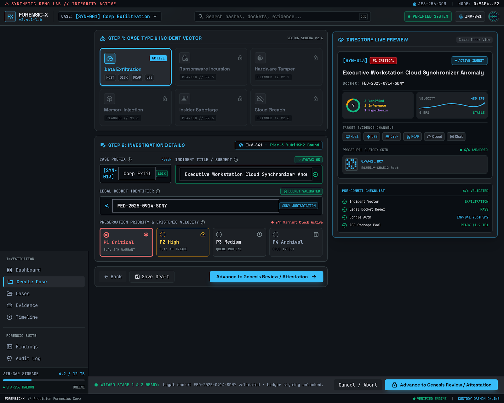
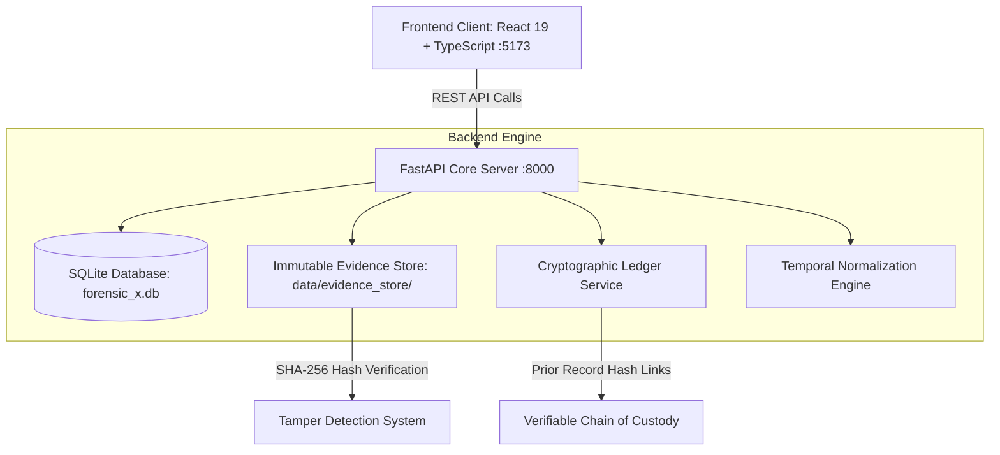

<div align="center">

# 🔬 FORENSIC-X
### Verifiable Digital Forensics & Incident Reconstruction Framework

[](https://opensource.org/licenses/Apache-2.0)
[](https://www.python.org/)
[](https://fastapi.tiangolo.com/)
[](https://react.dev/)
[](https://www.typescriptlang.org/)
[](https://tailwindcss.com/)
[](#cryptographic-chain-of-custody)

**FORENSIC-X** is a verifiable digital forensics investigation framework engineered to bridge raw digital artifacts and court-admissible forensic reconstructions. Built on strict **epistemic truth separation**, an **immutable on-disk evidence store**, and a **cryptographic blockchain-style chain-of-custody ledger**, it eliminates evidence contamination and retroactively falsified audit trails.

[Quickstart](#-quickstart-guide) • [Visual Showcase](#-visual-showcase) • [Architecture](#-system-architecture) • [Epistemic Tiers](#-epistemic-truth-hierarchy) • [Documentation](DOCS/)

</div>

---

## 📸 Visual Showcase

Explore the interactive interface and investigative tools built for **FORENSIC-X**.

### 1. Central Pipeline & Live Dashboard
Real-time telemetry showing backend node latency, SQLite persistence, active investigations, and 100% unbroken custody status.


---

### 2. Evidence Repository & Custody Matrix
Interactive artifact gallery with on-demand SHA-256 hash checks, live disk-level verification, and append-only custody inspector.


---

### 3. Temporal Event Reconstruction
Harmonized chronological sequence displaying incident deltas ($T-0$), raw timestamp mapping, and normalized UTC markers.


---

### 4. Case Overview & Cryptographic Audit Dossier
Comprehensive case tracking displaying seized artifact metrics, timeline clusters, and on-demand chain-of-custody auditing.


---

### 5. Investigation Intake Wizard
Structured 3-step intake workflow to create new investigations with strict investigator attribution.


---

### 6. Entity Relationship Graph
Correlating seized devices, user accounts, and observed exfiltration pathways into an investigative graph.


---

### 7. Analytical Findings & Epistemic Hypotheses
Separating raw verified physical proof from analytical inferences and investigative working hypotheses.


---

## 🏛 System Architecture

FORENSIC-X is designed around an append-only, tamper-evident architecture:



### Core Architecture Principles
1. **Immutable Storage ([ADR 004](DOCS/adr/004-evidence-storage.md))**: Ingested physical artifacts are written to `data/evidence_store/<case_id>/` and marked read-only.
2. **Cryptographic Chain of Custody**: Every custody action (`ACQUIRED`, `VERIFIED`, `ACCESSED`) links to the hash of the preceding record (`prior_record_hash`). Any database alteration breaks the chain.
3. **UTC Normalization**: Disparate log formats (syslog, auth.log, Windows EVTX, CSV) are normalized into ISO 8601 UTC with relative offset computation ($T-0$).
4. **Epistemic Truth Separation ([ADR 006](DOCS/adr/006-epistemic-tiers.md))**: Physical data is clearly demarcated from AI deductions or investigator hypotheses.

---

## 🧭 Epistemic Truth Hierarchy

FORENSIC-X categorizes all investigative knowledge into three distinct tiers:

| Tier | Name | Definition | Example |
|---|---|---|---|
| **Tier 1** | **Verified Physical Fact** | Cryptographically verified disk bytes, exact log records, file hashes. Immutable and indisputable. | `SHA-256: 59fa4e...` matching physical file on disk |
| **Tier 2** | **Analytical Inference** | Correlations derived mathematically from two or more Tier 1 facts. | USB device plugged in at `08:15` followed by file copy to `E:\` at `08:22` |
| **Tier 3** | **Investigative Hypothesis** | Plausible scenarios or motive theories requiring further corroboration. | "Exiting employee maliciously copied proprietary code to personal USB" |

---

## 🚀 Quickstart Guide

### Prerequisites
- **Python 3.12+**
- **Node.js 18+** & `npm`

---

### Step 1: Clone the Repository
```bash
git clone https://github.com/Mayank32935M/FORENSIC-X.git
cd FORENSIC-X
```

---

### Step 2: Set Up and Run the Backend

```bash
cd backend

# Create virtual environment
python -m venv .venv

# Activate virtual environment
# Windows:
.venv\Scripts\activate
# Linux/macOS:
# source .venv/bin/activate

# Install dependencies
pip install -e .

# Seed database with the synthetic "Phantom Exfiltration" scenario
python -m app.scripts.load_scenario

# Launch FastAPI development server
uvicorn app.main:app --host 127.0.0.1 --port 8000 --reload
```

The backend API will be live at:
- **API Health**: [http://127.0.0.1:8000/api/health](http://127.0.0.1:8000/api/health)
- **Interactive Swagger Docs**: [http://127.0.0.1:8000/docs](http://127.0.0.1:8000/docs)

---

### Step 3: Set Up and Run the Frontend

Open a new terminal window:

```bash
cd frontend

# Install frontend dependencies
npm install

# Start Vite dev server
npm run dev
```

The web application will be accessible at:
- **Interactive UI**: [http://localhost:5173/](http://localhost:5173/)

---

## 🧪 Testing & Verification

Run the automated backend test suite to verify hash computation, custody tamper-resistance, and API endpoints:

```bash
cd backend
.venv\Scripts\activate
pytest -v
```

Expected output:
```text
tests/unit/test_custody.py .      [ 20%]
tests/unit/test_hashing.py ....   [100%]
===================== 5 passed in 1.57s =====================
```

---

## 📂 Project Structure

```text
FORENSIC-X/
├── backend/
│   ├── app/
│   │   ├── api/             # FastAPI REST router handlers
│   │   │   ├── endpoints.py          # Cases & health endpoints
│   │   │   ├── evidence_endpoints.py # Ingestion & verification
│   │   │   └── timeline_endpoints.py # Timeline reconstruction
│   │   ├── core/            # Config, logging, error handling
│   │   ├── db/              # SQLAlchemy engine & async session
│   │   ├── models/          # Relational entities (ORM)
│   │   ├── schemas/         # Pydantic v2 data contracts
│   │   ├── scripts/         # load_scenario.py database seeder
│   │   └── services/        # Custody, evidence, and timeline logic
│   ├── tests/               # Unit & integration test suites
│   └── pyproject.toml       # Backend dependencies & packaging
│
├── frontend/
│   ├── src/
│   │   ├── components/      # UI components & Layout navigation
│   │   ├── pages/           # Dashboard, Evidence, Timeline, Cases
│   │   ├── services/        # Frontend API client (api.ts)
│   │   ├── App.tsx          # Client routing
│   │   └── index.css        # Tailwind design system tokens
│   └── package.json         # Frontend dependencies & scripts
│
├── data/
│   └── synthetic/           # Synthetic forensic logs (auth, syslog, csv)
├── DOCS/
│   ├── adr/                 # Architectural Decision Records (ADRs)
│   └── images/              # High-resolution prototype UI screenshots
├── LICENSE                  # Apache 2.0 License
├── CONTRIBUTING.md          # Contribution guidelines
├── SECURITY.md              # Security policy & evidence disclosure
└── README.md                # Project documentation
```

---

## 🗺 Roadmap

- [x] **Phase 1-4**: Core relational models, async database layer, FastAPI backend.
- [x] **Phase 5**: Evidence ingestion, on-disk SHA-256 verification, and hash-chain custody.
- [x] **Phase 5.5**: Frontend dashboard, evidence matrix, timeline viewer, and case wizard.
- [ ] **Phase 6**: Automated log parsers (Windows EVTX, Sysmon, PCAP).
- [ ] **Phase 7**: Dynamic entity graph visualization (React Flow / Cytoscape).
- [ ] **Phase 8**: Epistemic Tier classification engine & findings generator.
- [ ] **Phase 9**: AI Forensic Copilot integration for threat hypothesis analysis.
- [ ] **Phase 10**: Cryptographically-signed PDF/JSON-LD court report generation.

---

## 📄 License

This project is licensed under the **Apache License 2.0**. See the [LICENSE](LICENSE) file for complete details.
